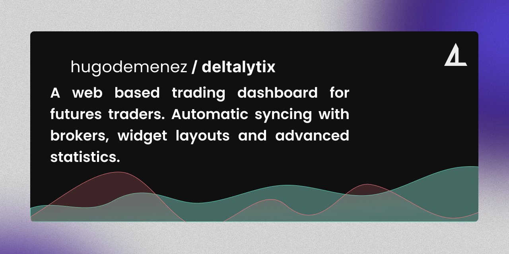
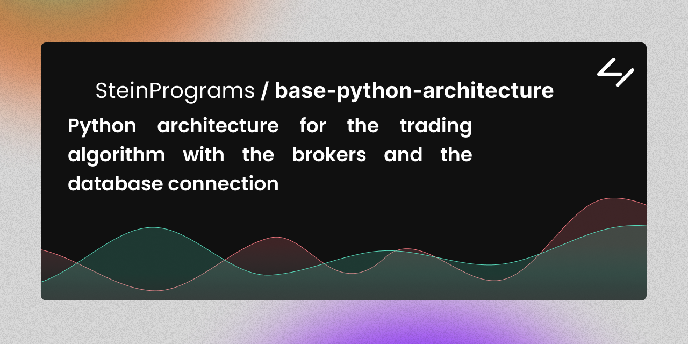
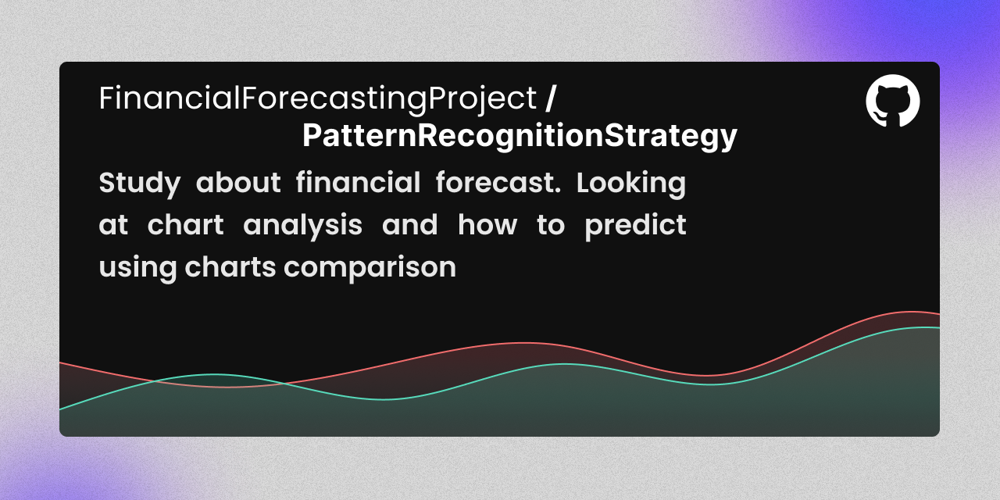
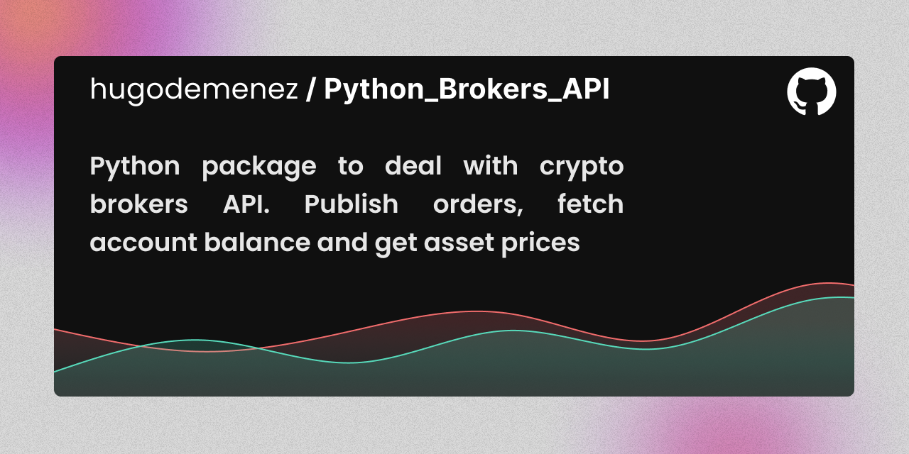
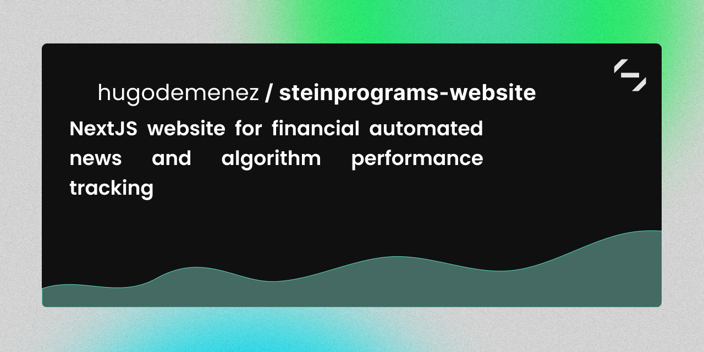
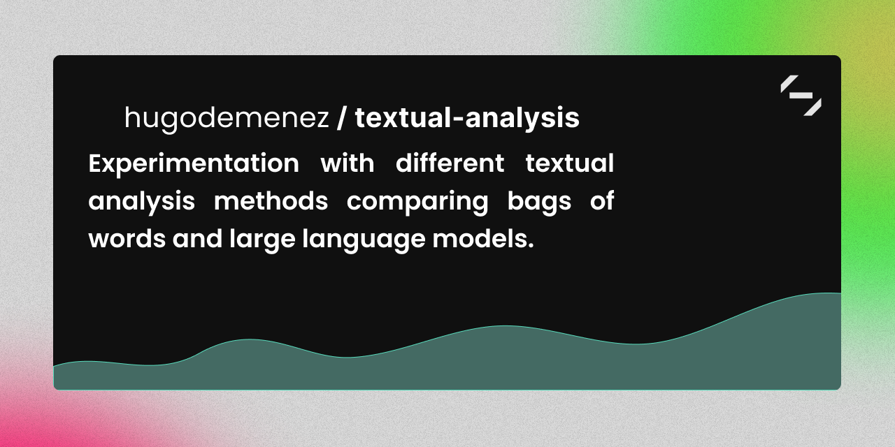

## Active repositories
|||
| ------------- | ------------- |
|[](https://github.com/hugodemenez/deltalytix)|[](https://github.com/SteinPrograms/base-python-architecture)|
|[](https://github.com/FinancialForecastingProject/PatternRecognitionStrategy.git)|[](https://github.com/hugodemenez/Python_Brokers_API)|
|[](https://github.com/hugodemenez/steinprograms-website)|[](https://github.com/hugodemenez/textual-analysis)|


## My Stats

<!--START_SECTION:waka-->


📅 **I'm Most Productive on Saturday** 

```text
Monday                   29027 commits       ███░░░░░░░░░░░░░░░░░░░░░░   11.15 % 
Tuesday                  37012 commits       ████░░░░░░░░░░░░░░░░░░░░░   14.21 % 
Wednesday                33405 commits       ███░░░░░░░░░░░░░░░░░░░░░░   12.83 % 
Thursday                 29372 commits       ███░░░░░░░░░░░░░░░░░░░░░░   11.28 % 
Friday                   39551 commits       ████░░░░░░░░░░░░░░░░░░░░░   15.19 % 
Saturday                 57641 commits       ██████░░░░░░░░░░░░░░░░░░░   22.14 % 
Sunday                   34394 commits       ███░░░░░░░░░░░░░░░░░░░░░░   13.21 % 
```


📊 **This Week I Spent My Time On** 

```text
💬 Programming Languages: 
Other                    7 hrs 43 mins       ███████████████████░░░░░░   77.72 % 
Python                   1 hr 7 mins         ███░░░░░░░░░░░░░░░░░░░░░░   11.24 % 
Markdown                 34 mins             █░░░░░░░░░░░░░░░░░░░░░░░░   05.79 % 
JavaScript               26 mins             █░░░░░░░░░░░░░░░░░░░░░░░░   04.37 % 
JSON                     4 mins              ░░░░░░░░░░░░░░░░░░░░░░░░░   00.74 % 
```

🤖 **AI Coding This Week** 

```text
⏱ AI Coding Time: 9 hrs 56 mins (99.94%)

✍️ 1,551 lines written by AI, 0 lines written by hand (100.0% AI-written)

🔤 1,731,958 Input Tokens, 298,537 Output Tokens

💵 $21.40 Estimated AI Cost This Week

🧠 50 AI Sessions, 76 AI Prompts

GPT                      1,571 lines         █████████████████████████   100.00 % 

🔎 AI Coding Insights:
🤖 AI-Driven — 100.0% of written lines came from AI
📝 Concise Prompter — average 230 characters per prompt
🔁 Iterative Prompter — average 2 prompts per session
🚀 High AI Trust — 0.0% of changed lines were hand-edited
```


 Last Updated on 26/10/2026 04:58:56 UTC
<!--END_SECTION:waka-->


